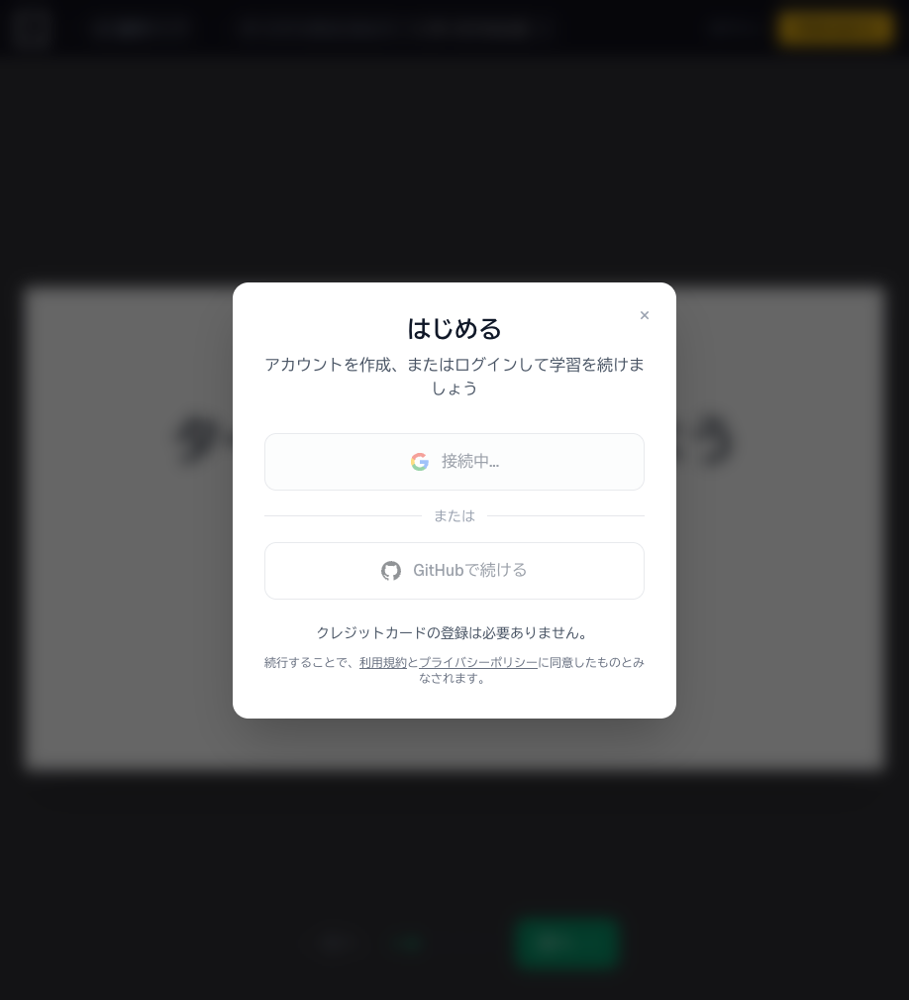
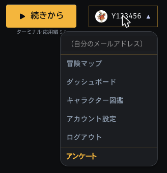
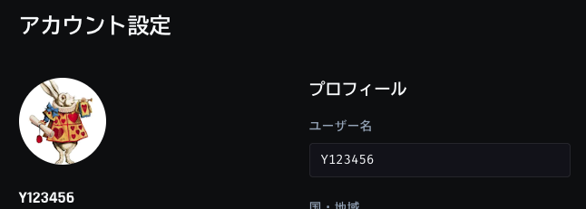
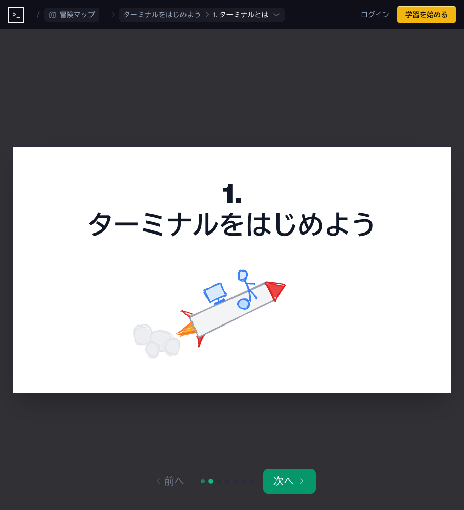
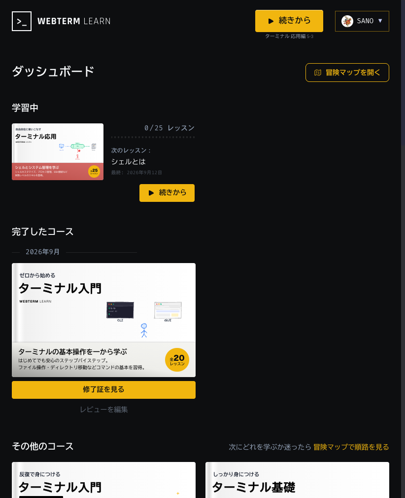

# WebTerm Learn でターミナル操作を練習する

[WebTerm Learn](https://learn.webterm.app/ja) は、ブラウザだけでターミナル（コマンドライン）操作を学べる無料の学習サイトです。
インストール不要で、ゲームのように「冒険マップ」を進みながらレッスンを進めます。

## Step 1: サインイン

トップページの **「学習を始める」** または **「冒険を始める」** から進むと、サインインを求められます。
**Google アカウント**（大学のメールアドレスでも可）または **GitHub アカウント**でサインインできます。
クレジットカードの登録は不要です。

## Step 2: ユーザー名に学籍番号を入れる（レッスンを始める前に）

!!! danger "修了証を取得する前に必ず変更してください"
    修了証には、**修了した時点のユーザー名**がそのまま印刷されます。サインインした直後は
    Google / GitHub アカウントの本名になっているので、レッスンを始める前に変更しておいてください。

    - **学籍番号が含まれていない修了証は減点されます。**
    - **一度発行された修了証の名前は、あとから変更できません。**

画面**右上のユーザー名（アバター）**をクリックし、開いたメニューから **「アカウント設定」** を選びます。

**「ユーザー名」** の欄を、自分の**学籍番号を含むもの**（例: `Y123456`、`Y123456 龍谷太郎`）に書き換えます。
このページに保存ボタンはありません。書き換えた内容がそのまま保存されます。

!!! tip "学籍番号の入っていない修了証を発行してしまったら"
    すでに発行された修了証の名前は変更できません。その場合は、ユーザー名を変更したうえで
    続きのコース **「ターミナル基礎編」** に取り組み、そちらの修了証を提出することができます。

## Step 3: 「根の森 — ターミナル入門編」を選ぶ

サインイン後、3D の「冒険マップ」が表示されます。いくつかの土地（コース）がありますが、
この課題で取り組むのは **「根の森」＝「ターミナル 入門編」** です。

「根の森」を選ぶと、レッスンが一本道のマップになって並んでいます。「1. ターミナルをはじめよう」から順番に進めてください。

## Step 4: スライドと演習でレッスンを進める

各レッスンは「スライドで説明を読む → 実際にブラウザ内のターミナルで操作してみる」という流れです。
指示通りにコマンドを打って進めていってください。

## Step 5: 修了証を取得して提出する

「根の森（ターミナル入門編、全 20 レッスン）」をすべて終えると、右上のメニューから
**「ダッシュボード」** を開いた際に「完了したコース」として表示され、**「修了証を見る」** から
修了証（Certificate of Completion）を確認できます。

修了証が表示されたら、**「PNG をダウンロード」** で画像として保存してください。

- ダウンロードした **修了証の PNG 画像を aiJudge の該当する課題に提出**してください。

!!! warning "修了証に印刷された名前は変更できません"
    表示されている名前が学籍番号を含んでいない場合、その修了証を直す方法はありません。
    Step 2 でユーザー名を変更したうえで、**「ターミナル基礎編」** の修了証を提出してください。
